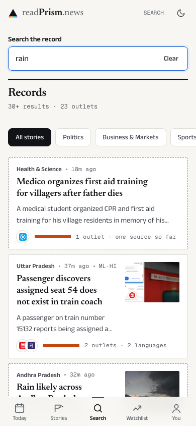
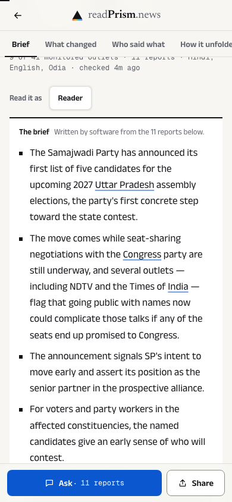
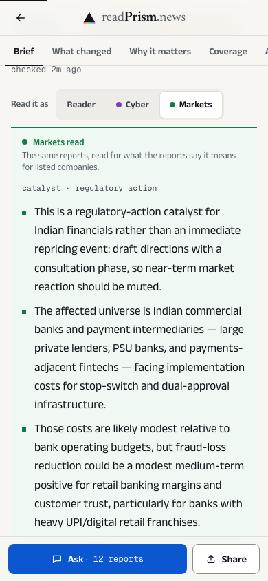
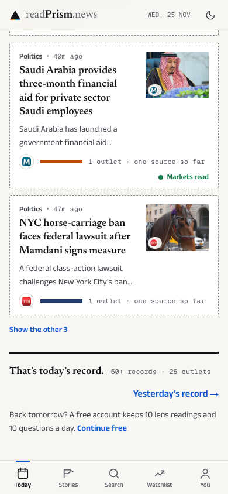

# 00 · Design audit — what is on the screen today, and what goes

2026-11-25 · task T-080 · decision D-23 · audited: the live site `www.readprism.news`, signed out, on
2026-11-25 between 00:35 and 01:00 IST.

This is a verdict on the interface as it is, and the brief the new design system is built from. It proposes
no new look: that is T-081. Nothing in the app was changed.

**The finding in one paragraph.** The founder's judgement holds, and it is larger than lines. The first
screen of Today carries 39 pieces of text in 18 type styles and 20 controls, and its first headline starts
two-thirds of the way down; a record prints its count of reports five times on one phone screen; a running
story opens on 18 chips and its oldest entry out of 5,695. Four independent design critiques, working only from screenshots, could not say
what the coloured bar under every card means, what "Verified" verifies, or what "Has a professional read"
is. The decoration the founder named is real but sits lower than the first screen: no hatching is drawn on
any page measured, and no dashed line is on the first screen of Today, the lead record or the
story. Dashed boxes start below it (about 12 on Today's page, about 18 on Search's) and in the code the
dashed line carries twelve different meanings. What clutters the first screen is repetition, small grey text, and
controls nobody asked for. **The redesign starts by removing those.**

## 1. How this was done

| Step | What | Where the evidence is |
|---|---|---|
| Capture | 88 screenshots of every reader route at 390×844 and 1440×900, plus 768×1024 for Today, a record and a story; dark theme; Hindi, Kannada and Urdu records; a one-outlet record; a record with three lens readings | names and exact addresses in [`audit-data/capture-log.md`](audit-data/capture-log.md); the 18 shots this document cites are in [`audit-shots/`](audit-shots/) |
| Count | A script counts what is visible on the first screen: text, controls, pictures, type styles, colours, kinds of line, pinned bars | [`audit-data/measure.js`](audit-data/measure.js) → [`counts.json`](audit-data/counts.json), 12 runs |
| Accessibility | A second script measures contrast, text size and target size on nine first screens | [`audit-data/a11y.js`](audit-data/a11y.js) → [`a11y.json`](audit-data/a11y.json) |
| Census | Every word a reader must learn, and every line and ornament device in `web/src`, counted | [`audit-data/census.md`](audit-data/census.md) |
| Five critiques | Five fresh reviewers, each with one method (`impeccable`, `design-taste-frontend`, `emil-design-eng`, `make-interfaces-feel-better`, an accessibility audit), given the screenshots and nothing else: no code, no DESIGN.md, no earlier findings. Each first wrote down what every device seemed to mean (the **cold read**) | [`audit-data/critiques/`](audit-data/critiques/) |
| References | 37 Mobbin searches across two files: how leading reading products show the same information, and what they leave out | `~/prism-program/design-refs/board.md` (rows A1–L6) and `audit-subtraction.md` (rows 1.1–14.4) |

**The rule for a finding.** A clutter finding stands when at least three of the four design critiques reached
it independently. An accessibility finding stands on its own when it is measured against a fixed constraint
(AA contrast, 44 px targets, state never by colour alone). What only one critique saw is in the appendix.

**Limits.** Signed-in states were not captured (there is no test account on production), so Following and You
are judged signed out. Mobbin holds iOS and web only: nothing here is evidence for Android or tablet
patterns. The scripts see only the first screen; text over photographs, borders' contrast, and everything
lower on the page were judged by eye. No keyboard or screen-reader test was run. The live site changes by the minute, so a count in one screenshot can
differ from another taken minutes later; where this document says two numbers disagree, both are in the same
screenshot or the difference is too large to be timing.

## 2. The baseline — the numbers the new design must beat

First screen at 390×844, light theme, not scrolled. Measured by `measure.js` and `a11y.js`
(2026-11-24 19:21 UTC); the rows marked *by eye* are the range across the four design critiques.

| | Today | A record | A running story | Search results |
|---|---|---|---|---|
| Pieces of text | 39 | 39 | 47 | 32 |
| Controls (things to tap) | 20 | 25 | 14 | 16 |
| Pictures (photos, logos, icons) | 13 | 28 | 3 | 13 |
| Type styles (family × size × weight × case) | 18 | 16 | 11 | 14 |
| Font sizes | 13 | 12 | 9 | 10 |
| Pieces of text in monospace | 14 | 5 | 18 | 8 |
| Text under 12 px | 19 of 39 | 11 of 39 | 17 of 47 | 11 of 30 |
| Smallest text | 9.5 px | 10.5 px | 11 px | 11 px |
| Text colours · fill colours | 4 · 9 | 6 · 9 | 4 · 6 | 4 · 8 |
| Targets under 44 px | 7 | 4 | 13 | 6 |
| Pinned bars, share of the screen | 110 px, 13% | 161 px, 19% | 52 px, 6% | 110 px, 13% |
| Things competing for attention, *by eye* | 14–17 | 17–20 | 9 groups to 27 items (18 chips) | not estimated |
| Lines of small grey facts, *by eye* | 5–6 | 4–6 | 4–5 | not estimated |
| Kinds of line and border, *by eye* | 7–9 | 8–10 | 5–6 | not estimated |
| Where the first headline starts, *by eye* | 65% down | 58% down | title at 15%; first entry at 91% | 42% down |
| Length of the whole page | 12 screens | 25 screens | 697 screens | 8 screens |

The pinned bars were measured on a 390×844 screen. On the 360×640 screen the accessibility checks use, the
record's 161 px would be 25% of the height.

Across the whole product (code census): **33** font sizes, 8 of them half-pixel steps · **150** custom
properties in the stylesheet, 105 of them literal colours · **7** families of pill, badge and chip, plus 14 one-off pills ·
**14** pinned or floating bars and overlays · dashed borders in about 50 style rules across 29 files, carrying **12**
meanings · 3 px rules in 25 places, the section heading that draws one used 51 times · about **32** product
terms a newcomer must learn, in 10 groups where one word means several things or several words mean one.

Accessibility, nine measured first screens (seven pages in light, Today and the record again in dark; the
story was not measured in dark): text contrast passes AA on all nine except one chip count (2.94:1, the
"5695" inside the selected chip on the story page). **52** targets are under 44 px across the nine runs, 41
of them distinct; 37 of the 52 are 32–42 px tall chips and pills, which pass WCAG's 24 px minimum and fail
only the 44 px house rule. The gaps between targets were not measured. On the record,
161 of 844 px is pinned, and text scrolls sliced under the tab strip.

*Two traps for T-081.* The script counts border **sides**, so use its kinds of line, not its totals (Today's
"48 dashed" is about 12 boxes). And it does not see chips: it reports 0 on the story page's 18, because it
looks for fully rounded pills. §6 says which target is checked by script and which by eye.

## 3. The ten worst problems

Ordered by how much of the product they spoil. "4 of 4" is the number of design critiques that reached the
finding on their own.

### 3.1 A running story never says where the story stands

The page opens with a sentence about Prism's process ("Each development was checked against this story
before it joined"), ten filter chips, eight name chips under the word "Following" (the reader is signed out
and follows nobody), and then entry one of 5,695, dated 23 September, oldest first. Nothing says what the latest is, and
today's news is 697 screens away. **4 of 4, critical in two.** T-007 is fixing the order on the live page.
What the top of this page holds is already decided in
[`../specs/06-story-header.md`](../specs/06-story-header.md): the story's name, four counted figures, the
latest development and the first. No written summary: nothing there is generated. The design has to make
that the first screen.

### 3.2 The coloured bar under every card means nothing to a new reader

All four design critiques wrote "no idea" for the navy-and-orange bar; three guessed a political or party
split, which is the one thing Prism must never appear to rate. Its key is on no card: it is printed inside a
record's Coverage section, on the desktop story page and on the About page. It has a fixed length, so it shows no quantity; at one
outlet it is a full bar of one colour; in dark the two colours are near-equal in lightness, so the split
rests on hue alone (colour as the only signal: WCAG 1.4.1). On the Stories list the same slot holds an identical grey bar on every
row, which is decoration. **4 of 4, plus accessibility.**

### 3.3 One count is printed five times on a record's first screens

On the lead record the count of reports, 11, is printed five times on a phone: in the byline, a tile, the
grey line under the bar, the brief's note and the pinned button. Desktop prints it six times
([`record-1440.png`](audit-shots/record-1440.png)). On a one-outlet record the digit 1 appears eight times,
for three different counts. The tiles are buttons that jump down the page, which no critic worked out: three
guessed and one had no idea whether they could be tapped. **4 of 4.**

### 3.4 Today puts five kinds of control above the first headline

Five things sit above the lead, in three rows: a count line, "For you · pick subjects →", a strip of days
with bare numbers, a row of subject chips, and a floating pill. The headline starts 65% of the way down. The numbers puzzle
rather than inform: "60+ records" beside "Yesterday 467", and "60+ records" above a chip reading "All
stories 60". One critique made this a finding and rated it critical; all four counted 14 to 17 things competing on this
screen, and the measured baseline (§2) is the evidence.
The behaviour that replaces it is in [`../specs/01-edition.md`](../specs/01-edition.md): a short, finishable
edition.

### 3.5 One feature has five names, a pill that hides other controls, and a switch with one option
 

"Has a professional read", "Markets read", "Read it as", "Reads as" and "lens" are one feature. All four
critiques wrote "no idea" for "Has a professional read", and the pill is pinned over the chip row, cutting
"Politics 23" in half at every width and in both themes. On the lead record and the one-outlet record "Read it as" offers one choice,
"Reader": a switch with nothing to switch to. Where three readings exist (second shot) it at least has
something to switch between; that state was not cold-read. **4 of 4, plus accessibility (one control covers another).**

### 3.6 "Verified" is on every row, so it tells a reader nothing

The black badge is the heaviest thing on each row and it is on every row, in two wordings ("Verified",
"Verified record"). No screen says who verified what. Meanwhile the thing a reader does need is missing:
the list says "23 moving now" and marks no row as moving or gone quiet, which the product's own rule requires
in words. **3 of 4 for removing the badge from lists; the missing state is an accessibility finding.**

### 3.7 On a phone, a record shows a photo gallery before the headline and keeps 19% of the screen pinned

Seven controls come before the headline: two arrows over the faces in the photo, a counter, a credit, "Their
report", and a strip of thumbnails. Three bars are pinned at once: the header, a seven-item tab strip that
clips its fourth label ("How it unfolde"), and Ask and Share. Together they hold 161 px, and the bottom bar
cuts the tiles in half. One reviewer counted "Ask" four times on one screen. Desktop already leads with the headline.
**4 of 4. A risk, untested, that keyboard focus is hidden under the pinned bars (WCAG 2.4.11).**

### 3.8 Four nouns for one news item, and numbers that disagree

A reader meets *record*, *story*, *development* and *report* for news items, and *outlets*, *sources* and
*reports* for who published them; "record" alone means five things (the product, one page, a row, a day, a
search result). Numbers that should match do not: "31 outlets" beside "Who reported it · 47" in one
screenshot; "63 days" on the story's page and "53 days" for the same story in the list; "24 outlets" at the top of
Today and "25" at its foot. (One query for these counts is part of T-007; it is a data matter, not a design
one.) A product whose promise is counting cannot print two counts for one thing.
**On the words: a finding in 2 of 4, a guess at "record" in all four cold reads, and the census. On the
numbers: 3 of 4.** The word list is in §7.

### 3.9 Half the text on a first screen is small grey facts
On Today, 19 of 39 pieces of text are under 12 px, down to 9.5 px; on the Stories list, 26 of 50. Each
screen carries four to six grey meta lines, most in monospace, and monospace is also used for whole
sentences ("most-reported first", "one source so far"). Language codes ("EN·HI·OR") were a guess for every
critic. Dots strand at line ends when a line wraps. **3 of 4, plus accessibility (text size).**
See [`today-390.png`](audit-shots/today-390.png) and [`today-390-dark.png`](audit-shots/today-390-dark.png).

### 3.10 The same shape and the same line mean many things

A dashed border means one source here. Elsewhere it means provisional, unverified, reported speech, an empty
state, something not open yet, the founding plan, a refunded payment, an unreachable feed, a limit reached, a
disabled field and a day not counted: twelve meanings in the code. A one-source card stacks four signals
for one fact (dashed frame, one-colour bar, "1 outlet", "one source so far"), and where such cards run
together they read as placeholders. The white rounded rectangle is likewise a filter, a link to a name's page, a
jump down the page, a mode switch and an action, so a reader cannot tell what a tap will do. **The dashed
line: 2 of 4, and the census. The rectangle: one critique. This is also the founder's own complaint.**

## 4. The ledger — every recurring device, with a verdict

**Understood cold** is the cold read of the four design critiques (and the accessibility reviewer where
noted): *sure*, *guess* or *no idea*. **Verdict:** keep · simplify · merge · remove. References are rows in
`design-refs/board.md` (A1–L6) and `design-refs/audit-subtraction.md` (1.1–14.4).

| # | Device (where, how many) | The job it does for a reader | Understood cold | What calm products do instead | Verdict and reason |
|---|---|---|---|---|---|
| 1 | **3 px ink rule** above sections and on the lead card (25 places; the section heading used 51 times) | "A section starts here" | guess ×3, sure ×1; on the lead card "lead?" | Whitespace separates; one hairline or one heavy rule per page at most (12.1, 12.2); NYT settings use one heavy rule per section and no hairlines between rows (5.2) | **Simplify.** A heading and space already start a section. One meaning only; off the lead card |
| 2 | **Dashed border** (about 50 style rules, 29 files, 12 meanings; none on the first screen of Today, the lead record or the story; about 12 boxes on Today's page, about 18 on Search's) | "One source so far" | Not on a first screen, so not cold-read. Where critics met it with its words, three called it the right idea | State is a word plus a time: "LIVE 30m ago", "The End" (9.1, 9.2). **No reference found** for a one-source label in any news product | **Simplify.** The state stays and is said in words (fixed). At most one meaning for any line form, always beside its words; the other eleven uses go. Whether a line form survives at all is T-081's |
| 3 | **Dotted line** (5 lines: the route map and status grid on `/about`) | "Not built yet" | Not seen on a reader page | Onboarding is one card and one promise (6.3, E6) | **Remove.** It reports the state of the product, not of the news |
| 4 | **Hatching** (7 definitions, 3 uses: days not counted in a chart and the archive, the wire segment of the bar; none drawn on any page measured) | "Prism was not reading that day" | Not seen | An empty state says its window in words (K3) | **Merge** into the words "Not counted", which are already printed beside it. The wire hatch goes with the bar |
| 5 | **Coverage bar**, navy and orange, on every card, record and story | Which kinds of outlet carry the story | no idea ×4 | A count and a time as one line: "13 ARTICLES · 4 HR AGO" (8.1, 8.2, A4); where a split is drawn, the count heads it and the bar is secondary (8.3); a split with labelled segments only inside the story (C5) | **Remove** from cards and rows. In one place inside a record, the split by kind of outlet is said in words with its counts; its form is open. Never drawn at one outlet. Problem 3.2 |
| 6 | **Grey bar** under each title on the Stories list | None: it is the same on every row | read as decoration ×4 | Count as an eyebrow (8.2) | **Remove** |
| 7 | **Outlet-logo stack** "+6" on cards and records | Which outlets | sure ×4 that outlets are meant; logos are 16–22 px and unnamed, so not which | No logos on the card; the count is the credential (8.1). Who reported is a plain list with names (8.4) | **Merge** into the one count line. Logos stay only beside an outlet's name |
| 8 | **Language codes** "EN·HI·OR" on card meta lines | Which languages reported it | guess ×4 ("OR is Odia?") | Languages by their own names (E2) | **Remove** from rows; "in 3 languages" where it matters, names inside the record |
| 9 | **Monospace meta lines and uppercase eyebrows** (14 mono items on Today's first screen; 4–6 meta lines a screen; eyebrow class on 48 lines) | Time, counts, where a fact came from | "this is data, but used for sentences too" | One meta line per row, two items (1.1, 1.2, 1.3, 4.1) | **Simplify.** One meta line per row, at most two items, 12 px or more, never a sentence in monospace. Whether monospace survives is T-081's. Problem 3.9 |
| 10 | **Stat tiles** (9 · 3 · 11) on a record; each is a button that jumps down the page | Outlets, languages, reports | guess ×3, no idea ×1; nobody knew they could be tapped | One number, one sentence (12.3); the count heads the section (8.3) | **Merge** on a record: the count sentence beneath them already says it. Where a spec keeps counted figures as links (the story header, spec 06) they stay: each printed once, each opening what it counts, each looking like the link it is. Problem 3.3 |
| 11 | **Status pills**: "Verified record", "Verified", provisional, single, corrected (9 components) | The state of a record or story | no idea ×2, guess ×2 for "Verified" | A state is a word and appears only when true (9.1, 9.2, 1.2) | **Simplify.** No badge for the normal state. Words for the exceptions (one source, provisional grouping, corrected). In a mixed list every row says whether its story is moving or has gone quiet, or sits under a heading that does; never by the absence of a mark. Problem 3.6 |
| 12 | **Chip rows**: subjects with counts on Today and Search, 10 kinds and 8 names on a story (59 uses in about 30 files) | Filter the list | sure ×3 for subject chips; guess for "The event 1969"; no idea ×4 for "Following" | One "Filter by" control (10.1–10.4); or text tabs for kinds (4.2, 4.4) | **Simplify.** At most one chip row on a screen, on one line. A story's ten kinds and eight names do not both sit above its timeline; the name chips merge with the list of people and organisations named |
| 13 | **"Has a professional read" toggle** on Today | Show only items with a specialist reading | no idea ×4 | An affordance appears on the row it is true for (1.2) | **Remove** from the first screen. Problem 3.5 |
| 14 | **Day tabs with bare numbers** on Today | Move to another day | guess ×4; the numbers contradict the line above | One text control or a dated heading reaches any date (11.1–11.3); the date is the masthead (A2) | **Simplify.** One way to reach another day; every number with its noun. The archive calendar already does this well. Any swipe has a button that does the same |
| 15 | **Photo deck and thumbnail strip** on a record (arrows, counter, credit, link, 8 thumbnails) | See the outlets' photographs | sure ×2 for the deck; the outlet pill on the photo, sure ×2, guess ×2 | Photograph under the headline and summary, with its credit (2.3); a small thumbnail on a list row; none on a timeline entry | **Simplify.** Headline first; one credited photograph; the rest on request. Problem 3.7 |
| 16 | **Section tabs** on a record (seven, pinned, clipped on a phone) | Jump within the page | guess ×4 | While reading, one control is all that stays on screen (2.1, 2.2) | **Remove** as a pinned bar on a phone. The sections stay real headings, so a screen reader and a keyboard can still jump between them. "What changed" is the list of reports again: **merge** it with who reported it |
| 17 | **Ask and Share bar**, pinned on a record | Ask a question of the reports; share | guess ×4 for "Ask · 11 reports" | One action surface, never two (14.1–14.3; 14.4 is the counter-example); a single floating Ask (C7) | **Simplify.** One action surface on a record; Ask offered once, with no count on the button |
| 18 | **Lens switch** "Read it as" | Read the same reports for a profession | no idea ×4 at one option; at three options it was not cold-read | Two modes are one pill; three or four are text tabs (13.1–13.3) | **Simplify.** Shown only when a second reading exists; one name everywhere. Whether the lens flip survives is T-081's |
| 19 | **Header's right slot**: the date, a clock, or the page's own name in capitals (6 routes) | None on five of the six | read as an echo ×4 | The date is the title, once (A2) | **Remove.** Navigation holds the five destinations and the wordmark and nothing else (`specs/05-navigation.md`, rule 3); the date is Today's own heading (`specs/01-edition.md`) |
| 20 | **Footers**: the site footer (two groups of links, read from the component; hidden inside the app on a phone); the end blocks of Today and a record | The legal pages; "you have finished" | The end block was read correctly by the one critic who discussed it | "You're caught up" as a closing block (B1) | **Keep.** The footer group now titled "The record" needs another title (§7). Help and the grievance contact must be reachable in the same place at every width, which the phone app pages do not offer today |
| 21 | **Bottom tab bar** (5 tabs, see-through; absent on record and story; "Watchlist", with Pulse behind it) | Reach the five destinations | sure ×2, guess ×1 for the blue tick | Four or five tabs with an icon and a word (L1, L2) | **Simplify.** Opaque, so no page text shows through it; the five fixed names; leaf pages as [`../specs/05-navigation.md`](../specs/05-navigation.md) says |
| 22 | **"For you · pick subjects →"** pill on Today | Personalise | guess ×3 | Ask later, in context (6.1, H3) | **Remove** from the first screen; it lives in You and in onboarding |
| 23 | **Timeline rail** (dot, time, headline, "1 source") | Order of events | sure ×4 | A time gutter and one line per entry (3.1–3.4, C3); newest first (C4) | **Keep** the form. Order and paging are T-007's and T-052's |
| 24 | **Quote cards** and their actions | The exact words, who said them, where | understood | not searched: no reference | **Keep** the quote. **Simplify** its four small text actions (about 14–17 px tall, 8–12 px apart) to targets of 44 px |
| 25 | **Report rows** (logo, outlet, time, headline in its own script, [n]) | One outlet's report | understood | A plain list of who reported (8.4) | **Keep** |
| 26 | **Blue-underlined names** inside a summary | Open that person's, party's or place's page | guess ×4 ("India too?") | not searched: no reference | **Keep** as links, in the one link style the system has. Which names deserve a link is a data question |

## 5. What is good and must survive

Agreed by at least three of the five reviewers unless marked.

1. **The headline wins.** A serif headline over plain sans text, and one blue kept for actions.
2. **One source is said in words.** "One source so far" beside the item: state without colour.
3. **Quotes.** The exact words, the speaker and role, the outlet, and the rule printed above them: "Only
   words found exactly in the article are shown." Reported speech is upright and labelled, never styled as
   a quote ([`record-390-quotes.png`](audit-shots/record-390-quotes.png),
   [`record-ur-390-y2.png`](audit-shots/record-ur-390-y2.png)).
4. **The report row**: outlet, time, the headline in the language it was printed in, and its number
   ([`record-390-coverage.png`](audit-shots/record-390-coverage.png)).
5. **Plain statements of who wrote what.** "Written by software from the 11 reports below" was read with
   certainty by three critics; "Headline by Prism · from 11 reports" was guessed, correctly, by three.
6. **Honest empty and blank states, with real numbers and no filler**: the archive calendar with a count in
   each day, blank search offering names and top stories
   ([`archive-390.png`](audit-shots/archive-390.png), [`search-blank-390.png`](audit-shots/search-blank-390.png)).
7. **An ending.** "That's today's record", with one next step
   ([`today-390-end.png`](audit-shots/today-390-end.png)). *(One reviewer, and reference B1.)*
8. **Onboarding**: one question a step, every step skippable, no account
   ([`onboarding-390.png`](audit-shots/onboarding-390.png)). *(Two reviewers.)*
9. **The "out of how many" sentence**: "9 of 41 monitored outlets · checked 4m ago" was read correctly; a count is
   printed beside every bar. *(Two reviewers.)*
10. **Text contrast** already passes AA on the nine measured first screens, but for one chip count.
11. **The timeline as a form**: a time, a line, a headline. Everyone read it correctly.

## 6. Subtraction targets

Two kinds. **Limits** are met by every direction in T-081. **Scores** are reported for every direction
against the baseline; lower is better, and a direction that misses an aim says why.

Where a behaviour spec in [`../specs/`](../specs/) lists what a surface contains, that content is given: the
targets count what a design adds to it, and never ask a design to drop something a spec requires.

**Scope.** Checked at 390×844 in light and dark, on Today, a record, a running story and search results. At
1440 only the type, line and count-once rows apply. The accessibility constraints in §8 are checked at
360×640.

### 6.1 Limits

| # | Limit | Today | How it is checked |
|---|---|---|---|
| 1 | A first screen holds navigation and what its spec lists (01, 05, 06), and nothing from §4 marked remove. A record and search have no spec yet: the headline or the results come first | five kinds of control above Today's headline | by eye, against the spec |
| 2 | The first headline starts in the top 40% of the screen (Today, record, search) | 65% · 58% · 42% | by eye, from the screenshot |
| 3 | A running story's first screen shows its name, where it stands and its latest development (spec 06) | the first entry shown is the oldest of 5,695 | by eye, against spec 06 |
| 4 | One count is printed once in a screenful, unless a spec prints it again | 5 times on a phone, 6 on desktop | by eye |
| 5 | On a row, how widely something was reported is shown one way: a count in words | 5 ways (logo stack, bar, tiles, count line, language codes) | by eye |
| 6 | No line of small facts beyond those a spec lists; on a surface with no spec, one per row with at most two items. A state ("One source so far") is separate from that line, is real text, and is never cut short | 4–6 a screen | by eye |
| 7 | At most two kinds of line (style × width) in a whole direction | solid at 1, 2 and 3 px and dashed at 1 px measured; a 3 px dashed, a dotted and a hatched form in the code | script (`lineKinds`, kinds only) and the component sheet |
| 8 | One line form or shape carries one meaning. A control's shape is never used for something that is not a control | dashed: 12 meanings | the component sheet |
| 9 | No hatching and no dotted line | 3 uses · 5 | script (`hatchedOrStriped`) and the component sheet |
| 10 | At most one chip row on a screen, on one line; it may wrap only at 200% text or at 320 px wide | four wrapped rows on a story | by eye (the script does not see chips) |
| 11 | No control covers another, and no separator is stranded at the end or start of a wrapped line | the pill over the chips; stray dots | by eye |
| 12 | No badge for the normal state; exceptions and moving-or-quiet are words | "Verified" on every row | by eye |
| 13 | At most two pinned bars at once, together at most 20% of 360×640 (128 px), opaque; nothing pinned when the screen is under 480 px high (specs README) | three at once on a record; 161 px; see-through | script (`pinned`) at 360×640 |
| 14 | Nothing is told by hue alone: every state reads in a greyscale screenshot, in both themes | the coverage bar | a greyscale screenshot |
| 15 | One name for one thing (§7) | five names for the lens | by reading |
| 16 | Every survivor in §5 has a place: each direction shows where it lives | — | a checklist on the board |

### 6.2 Scores

| Measure | Today · record · story · search, now | Aim | How it is counted |
|---|---|---|---|
| Pieces of text on the first screen | 39 · 39 · 47 · 32 | Today: at most half, 20 | script (`textElements`) |
| Controls on the first screen | 20 · 25 · 14 · 16 | Today: 12, which is navigation's six and two items of the edition | script (`controls`) |
| Type styles on a first screen | 18 · 16 · 11 · 14 | 8 or fewer | script (`typeStyles`), on a Latin screen, the wordmark left out. Counted separately per script, since each script has its own family |
| Font sizes on a first screen | 13 · 12 · 9 · 10 | 5 or fewer | the same |
| Font sizes in the whole scale | 33 | 8 or fewer, no half-pixel steps | the direction's own type scale |
| Pieces of text in monospace | 14 · 5 · 18 · 8 | reported | script (`monoTextElements`) |
| Text colours · fill colours | 4·9 · 6·9 · 4·6 · 4·8 | reported | script |
| Pinned height | 110 · 161 · 52 · 110 px | limit 13 | script (`pinned`) |
| Families of pill, badge and chip | 7, plus 14 one-offs | reported, each with its one job | the component sheet |
| Colour properties | 150, of which 105 literal colours | reported | the direction's palette |

Text size, target size and contrast are in §8's accessibility list; `audit-data/a11y.js` measures them. It
has no check for the gap between targets: that one is by eye.

## 7. Words — what a newcomer must learn today, and the plain replacement

T-046 applies these. The census found about 32 product terms; the ones a general reader meets are below.
Professional readings may keep their own vocabulary inside the reading.

**Where a spec gives a string, the spec's string is what ships.** Several rows below are already settled
that way and say so. Where this list wants a spec's string changed, it is a proposal: T-046 changes the spec
and the label together, or leaves both.

**The nouns.** *Report* — one article by one outlet. *Outlet* — a publisher. *Story* — something that runs
over days. *Development* — one dated entry in a story. *Record* is retired from reader labels. **One word is
open for T-046:** what a single item is called when it must be counted on its own. Spec 01 prints
`{n} stories` for the edition's items; spec 06 prints `{n} developments` for the same kind of item inside a
story; the Stories destination means the running kind. Every count carries its noun: no bare numbers.

| Today's word or phrase | What a newcomer makes of it | Plain replacement |
|---|---|---|
| record · the record · Records · Today's record · The record for 24 Nov | five meanings; "a news item?" | Not used. "Today", "24 Nov", "Results"; the footer group gets another title |
| Verified · Verified record | "verified by whom?" | Removed as a badge. The fact is the count sentence: `Reported by {k} outlets in {l} languages` (spec 01) |
| verified quote | a third meaning of "verified" | "Exact words" |
| Provisional grouping · Grouping under review · Grouping provisional · Related reporting | one state, four strings; never explained where it appears | One string, `Provisional grouping`, always with its sentence: `These reports may belong together. Prism has not confirmed an order of events.` (spec 06) |
| Single source · not yet corroborated · one source so far | "corroborated" is never explained | `One source so far` (specs, fixed) |
| lens · professional read · Markets read · Read it as · Reads as | no idea | One name. T-046's candidate is "a closer reading" ("Markets reading"). The accessibility review objects that it is an idiom, hard to translate, and that "read" is ambiguous when spoken; its alternative is "Explained for: Markets". T-046 chooses one |
| The brief | understood with its note | "Summary", keeping "Written by software from the 11 reports below" |
| Prism's reading · Headline by Prism · Headline as filed by {outlet} | "as filed" is unclear | `Prism's headline, from {k} reports` · `{Outlet}'s headline` (spec 01) |
| Coverage · coverage bar | a section, a bar and a concept | `Who reported it` (spec 06) |
| monitored outlets · denominator | jargon | "9 of the 41 outlets Prism reads" · "out of how many" |
| source · sources (an outlet, an article, or a feed) | three meanings | "outlet" for a publisher, "report" for an article; kept only in `One source so far` |
| wire | not defined | The agency by name: `{Wire}, carried by {c} outlets` (specs README) |
| What changed | promises a comparison, lists the reports | "Latest reports", merged with `Who reported it` |
| developments · All developments · How it unfolded · How this story unfolded | one list, four labels | Count noun `developments` (spec 06); one heading, "How it unfolded" |
| The event · Investigation · Response … (unlabelled chips) | "The event" is a guess | A labelled control, "Show: {kind}"; "The event" becomes "What happened" |
| Following + name chips on a story | no idea (signed out) | "People and organisations named" |
| main line · branches · cast | internal | Not shown |
| Stories · Developing stories · Developing over days · Stories developing over days | one thing, four labels | "Stories"; one sub-heading, "Stories that run for days" |
| Watchlist · signals · your signals · follows | one feature, three words | "Following" (the fixed destination) |
| Pulse · Market Pulse · Market pulse · The read | three spellings | "Markets" · "Summary" |
| most-reported first · Most reported | reads like "most clicked" | "Reported by the most outlets first" |
| EN·HI·OR | a guess | `in {l} languages`; inside a record, the languages by name |
| Ask this story · Ask the record · Ask · Dig deeper · Not in sources · Limit | one feature, four names | "Ask about this story" · "Not in the reports" · "Daily limit reached" |
| reported (on a quote) · translation | easily missed | "Reported, not a direct quote" · "Translated" |
| On X · First on X · Signal, not coverage · Heard on | "signal" is internal | "Posts on X" · "Posts, not news reports" · "From podcasts" |
| Not counted · not read · Not read yet | one state, three phrasings | `Not counted yet` (specs README) |
| quiet since 24 Nov 14:22 (header) | unexplained | Removed with the header slot. A quiet story is `Nothing new in {d} days.` (spec 06) |
| Scope · National | internal | "Where": "All India" or the state's name |
| Hub · Sector · Subject · Entity | page types | "Subject"; a person, organisation or place by its name |
| catalyst · tickers · KEV · CVSS · CVE · PoC · GRC | professional terms shown to everyone | Only inside a professional reading, never on a general row or chip |
| "Each development was checked against this story before it joined." | no idea | Removed. The story header is four counts and two headlines, with no sentence (spec 06, rule 1) |
| "free box rests" (Plus page) · "30 d" | unreadable | Rewrite in full words; "30 days" |

## 8. The brief for T-081

**The task.** Three directions that each remove what §3 and §4 condemn, meet every limit in §6.1, report
every score in §6.2, and keep everything in §5. The four screens are Today as an edition, a record, a
running story and search results.

### Principles
1. **Subtract first.** The default answer to "should this element be here?" is no. An element stays when a
   first-time reader can say what it means without a key.
2. **A number is printed once in a screenful**, in words and digits, and means the same thing wherever it
   appears.
3. **Words carry state.** One source, provisional, moving, gone quiet, corrected: each is a word. Form may
   repeat what the word says; it never replaces it, and one form never means two things.
4. **The headline before the photographs, and the latest before the history.** On a phone record the
   headline comes first (problem 3.7); on a story, where it stands comes before its timeline (problem 3.1).
5. **One of each**: one chip row a screen, one place for a page's actions, one name for a thing, one way to
   show how widely something was reported.
6. **Whitespace before lines.** A line is used when space cannot do the job.
7. **Thirteen scripts are first-class.** Sizes, line heights and direction are set per script, not inherited
   from Latin (a fixed requirement; D-23).
8. **Dark is designed in its own right.** In dark today the coverage bar's two colours are near-equal in
   lightness, and page text shows through the bottom bar
   ([`today-390-dark.png`](audit-shots/today-390-dark.png)). Each direction is drawn in both themes.

**The cold read**, for every direction: four fresh reviewers, given only the screenshots, write what each
device and each word means. A device passes when at least three of the four are sure, and right.

### Fixed — the product, not the style
- The name Prism; the wordmark is the address `readPrism.news`. How it is drawn is open.
- Counts are counted and printed as numbers; below 30 a share is "3 of 4". Quotes are verbatim or absent.
  Nothing Prism writes is shown as fact unless checked, and it is labelled as Prism's. No outlet or tone
  ratings, and nothing that can be read as one.
- One source versus many, and moving versus gone quiet, are visible **in words**, never by colour alone.
  "Gone quiet" is spec 06's definition: no development in 7 days or more, said as `Nothing new in {d} days.`
  and `Last development`. In a list every row says which, or sits under a heading that does.
- Thirteen languages and their scripts, Urdu right to left. Reduced motion.
- The low-end Android budget. No figure exists yet: T-059 measures the web on a ₹8–10k phone. Until then
  each direction reports its font files and their sizes, as T-081 already requires.
- The five destinations: Today · Stories · Search · Following · You; the reader loop in
  `~/prism-program/PLAN.md` §2.3.
- The behaviour in [`../specs/`](../specs/) (the edition, follow, notifications, language, navigation, the
  story header): what each surface contains and says is decided, and where a spec gives a string it wins.
  How it looks is not decided.

### Accessibility constraints
Each is marked **WCAG** (required at level AA, with its number) or **house** (Prism's own, stricter rule).

1. **House.** Targets at least 44×44 px and 8 px apart, at 360×640. Links inside a sentence, and the
   citation numbers `[n]`, are exempt. *(WCAG 2.5.8 asks 24 px.)*
2. **WCAG 1.4.3.** Text at least 4.5:1 (large text 3:1) in both themes, sampled over photographs and blur.
3. **House.** No text under 12 px; Indic scripts at least 14 px and Urdu at least 16 px. *(WCAG sets no
   floor.)*
4. **WCAG 1.4.1.** Every state has a word and reads in a greyscale screenshot, in both themes.
5. **WCAG 1.4.11.** At least 3:1 for lines that carry state, control borders, meaningful icons, focus rings,
   and neighbouring segments of anything drawn as a split.
6. **House.** Pinned bars as limit 13 in §6.1.
7. **WCAG 2.4.7, 2.4.11.** Every element that takes focus shows a focus ring of at least 2 px and 3:1, in
   both themes, never hidden under a pinned bar.
8. **WCAG 1.4.4, 1.4.10.** At 320 px wide and at 200% text, nothing is lost and nothing scrolls sideways;
   zoom is never disabled.
9. **WCAG 1.4.12; house figures.** No clipped or touching glyph in any of the 13 scripts. Start from a line
   height of 1.6 for Indic scripts and 1.8 for Urdu, and confirm by testing. No letter-spacing and no
   capitals on a non-Latin script. Italics on Latin text only.
10. **WCAG 3.1.2.** Every headline, quote and outlet name that is not in the interface language carries its
    language.
11. **WCAG 1.3.2; fixed.** Every Urdu string is marked right to left; its lines start at the right;
    arrows and other directional icons mirror; Latin names, digits and `[n]` inside it are isolated.
12. **WCAG 1.3.1, 2.4.6.** One main heading a page; sections are real headings, so removing the pinned
    section tabs loses no way of jumping.
13. **WCAG 2.2.2, 2.3.3.** Nothing advances by itself without a pause control, for anyone. With reduced
    motion, nothing moves.
14. **WCAG 2.5.7.** Every swipe (a photo deck, a day strip) has a button of 44 px that does the same.
15. **WCAG 4.1.3.** A changed filter count, a limit reached, an answer arriving and a changed reading are
    announced as status messages.
16. **WCAG 3.2.6.** Help and the grievance contact are in the same place at every width.

### Open — decide on merit
Palette; typefaces; the mark's drawing; every line and rule; whether any dashed form survives; whether
monospace survives; how the split by kind of outlet is drawn inside `Who reported it`; how a professional
reading looks and whether the lens flip survives; density; rows or cards; photographs; chips and tabs; the
landing page; the character of dark. *Not open, because a spec decides them:* what an edition item says and
in what order (01), what a story's header holds (06), what navigation holds at each width (05).

### What each direction must answer, on the same screens
| Question | Why it is asked |
|---|---|
| How does the count sentence, `Reported by {k} outlets in {l} languages`, look on a row, once? | Problems 3.2, 3.3; ledger 5, 7, 8, 10 |
| How does a reader tell one source from many, and moving from gone quiet, in a greyscale screenshot? | Fixed; problem 3.6. No reference exists for a one-source label, so this is original work |
| What is on Today's first screen, and where does the first headline start? | Problem 3.4; `specs/01-edition.md` |
| The edition's lead item **with and without** a credited photograph | The founder's request (the answered request for T-047); settled with D-24 |
| How do a story's name, four figures, `Latest` and `Began` fit a first screen? | Problem 3.1; `specs/06-story-header.md` |
| What is on a record's first screen on a phone, and what is pinned on each of the four screens? | Problem 3.7 |
| How does a professional reading appear when there is one, and when there is none? | Problem 3.5 |
| What tells a reader that something can be tapped, and what a tap will do? | Problem 3.10 |
| What separates sections, and what are the direction's two kinds of line? | Ledger 1–4 |
| A fact line that does not fit its row; a row of chips or days that continues sideways | Problem 3.9; appendix A |
| Loading, empty, error, and a figure not counted yet (`—`, `Not counted yet`) | Specs README |
| One whole screen in Urdu, mirrored | Accessibility 11 |
| What does dark look like as its own design? | Principle 8 |

### Worst-case content every direction is tested with
T-081's own list (a 14-word Malayalam outlet name, a count over 99, a one-outlet record, a headline of 160
characters), and from this audit: a story of 5,695 developments; a row in Urdu among Latin rows; Odia and
Devanagari headlines on two lines; a record with no photograph; a signed-out reader on Following; search
with no results; an edition of three items; a story with a provisional grouping; a story gone quiet; a
quote whose attribution line has five parts; a `9+` count.

### Inputs
- Real records for the screens: `~/prism-program/design-refs/sample-records-2026-11-24.json`.
- References: `~/prism-program/design-refs/board.md`, `audit-subtraction.md`, and the per-surface files.
  The patterns that recur across the calm products are listed at the end of `audit-subtraction.md`.
- The baseline and the scripts: `audit-data/`.
- Not evidenced here, so to be designed with care: signed-in states; Android and tablet patterns (Mobbin
  has none: say "from memory, not Mobbin"); a label for one-source or unconfirmed news (no reference found).

## Appendix A — seen by one or two reviewers only

These did not meet the rule in §1. They are leads, not findings.

| Lead | Seen by | Shot |
|---|---|---|
| Dark theme is an inversion: the warm paper becomes a cool blue-black; the 3 px rule, the selected chip and the Verified badge turn solid white and out-shout the headline; card borders and tiles nearly vanish; photographs are not dimmed | emil, who read the dark shots as desktop frames | [`today-390-dark.png`](audit-shots/today-390-dark.png) |
| In dark the bar's two colours are near-equal in lightness; page text shows through the bottom bar | accessibility; emil | the same |
| The Urdu headline in a report row is set left to right: its second line hugs the left and the arrow points against the reading direction | emil, accessibility; two others listed it as a worst case | [`record-ur-390-y2.png`](audit-shots/record-ur-390-y2.png) |
| Odia and Devanagari headlines use Latin line height; below-base forms nearly touch the next line | accessibility | [`record-390-coverage.png`](audit-shots/record-390-coverage.png) |
| Desktop Today leaves the left column empty beside "Developing over days"; two search fields on desktop Search | 4 of 4, low severity; desktop layout is T-042 and T-044's | in the workspace's capture folder |
| The landing page explains how Prism works before why to read it; "STEP 01" labels and a ten-step index | design-taste | not copied |
| Plus: "Monthly" selected above a yearly card; both buttons say "Opens soon" | design-taste | not copied |
| Summaries cut mid-word; pale thumbnails bleed into the page; headline capitalisation is mixed; "rain" matches "training" in search | make-interfaces-feel-better | [`search-390.png`](audit-shots/search-390.png) |
| A 2 px reading-progress line at the top of a record; a keycap "1" beside the reading switch; three theme switches | emil, design-taste | not copied |
| Outlet logos at 16–22 px with no name; arrows on see-through plates over photographs | accessibility | [`record-390.png`](audit-shots/record-390.png) |
| A clipped word is the only sign that a row of tabs, days or chips scrolls sideways | accessibility, emil | [`record-390.png`](audit-shots/record-390.png) |
| The white rounded rectangle does five jobs (problem 3.10) | make-interfaces-feel-better | [`story-390.png`](audit-shots/story-390.png) |

## Appendix B — where the reviewers disagreed

- **The dashed border.** Three reviewers listed "dashed plus the words *one source so far*" among the things
  that work; two said the dash is overloaded and that one-source cards in a run look like placeholders. Both
  are true: the words work, the line is carrying too much. The verdict (ledger 2) keeps the state and the
  words and leaves the line to T-081.
- **The coverage bar.** Verdicts ranged from "remove from cards, keep once with its key" to "replace with
  words" to "a bar scaled by count, with a key". All four agree it cannot stay on cards as it is.
- **The day strip.** One reviewer would keep it and drop the pill and the "For you" row; none defended the
  bare numbers.
- **Navigation on a record.** One reviewer wants the tab bar on every page; the references remove it while
  reading (2.1, 14.1). The behaviour is already decided in `specs/05-navigation.md`.
